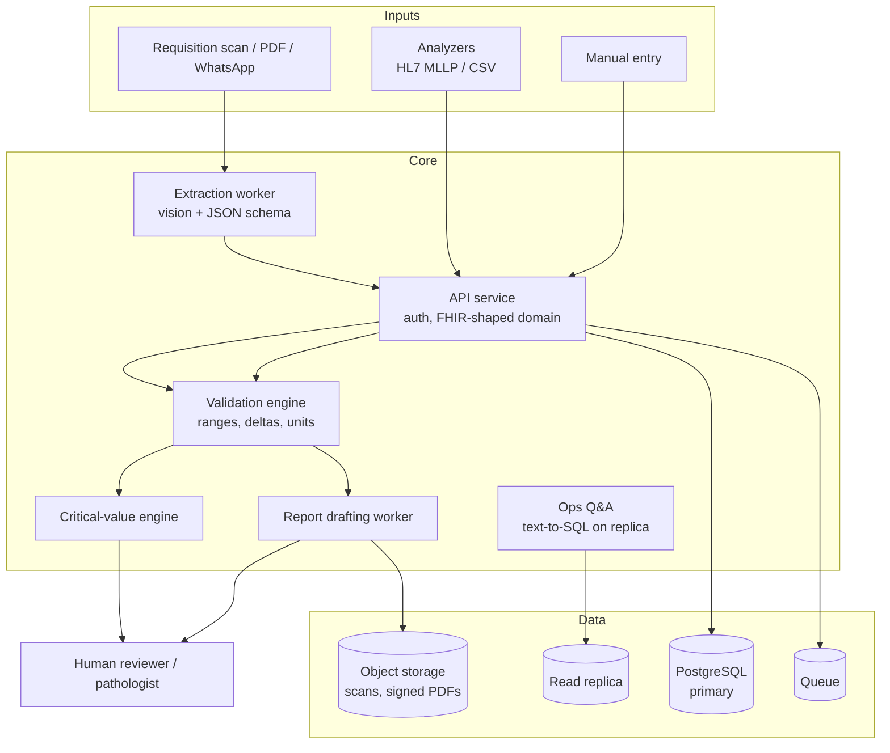

# Lab Assistant AI — diagnostic lab operations assistant

> An AI layer for a medical diagnostic laboratory that sits on top of the
> existing LIS: reads requisitions, drafts reports under review, flags critical
> values, and answers operational questions — while every clinical decision
> stays with a human and every AI output is auditable.

**Status:** design specification and implementation roadmap. See
[docs/roadmap.md](docs/roadmap.md).

**Safety position, stated up front:** this system is decision *support*. It does
not diagnose, does not issue a final report, and never auto-sends a result to a
patient. Every AI-drafted report is reviewed and signed by a qualified person.
The build target is ISO 15189-style traceability and auditability, not
autonomy.

---

## The problem this solves

A mid-sized Pakistani lab handles hundreds of samples a day. Results are entered
or imported from analysers, reports are typed by hand, critical values are
phoned in inconsistently, and the same doctor calls twice to ask "is this
urgent?" Data exists but is not usable at the moment it matters.

The assistant does four jobs well:

1. **Intake** — parse the requisition and match tests to the catalogue
2. **Report drafting** — assemble a structured draft from validated results
3. **Critical-value workflow** — detect panic values and drive the escalation
   call log
4. **Operational Q&A** — "how many HbA1c are pending?" answered from the LIS,
   not from a hallucinating model

---

## What the AI does — and what it must never do

| AI may | AI must never |
|---|---|
| Extract structured data from a scanned or PDF requisition | Diagnose or interpret a result for a patient |
| Draft narrative text around validated numeric results | Change, round or "fix" a value |
| Flag that a value crosses a configured panic threshold | Decide that a flag is unimportant and suppress it |
| Summarise a trend for the reviewing pathologist | Send anything to a patient or doctor without a signed review |
| Answer staff questions by querying the LIS | Answer from model memory when the data isn't in the LIS |
| Suggest the next test based on a configured workflow | Suggest a diagnosis or treatment |

Every model output is labelled as a draft, carries the model name and version,
and is stored with the prompt and the retrieved data that produced it.

---

## Modules

### 1. Order intake
- Scan/PDF/WhatsApp requisition → structured test list with confidence scores
- Ambiguous or low-confidence items go to a human queue, never guessed through
- Test catalogue matching (synonyms, spelling variants, Roman Urdu names)
- Duplicate-order detection (same patient, same test, within a configurable window)
- Barcode/label generation on acceptance

### 2. Result intake and validation
- Analyzer interfaces: HL7 v2 (MLLP), CSV drop folders, and a manual entry screen
- Pre-analytical checks: sample type, fasting flag, collection time window,
  haemolysis index where the analyser provides it
- **Delta checks** against the patient's previous result, with age/sex-aware
  reference ranges
- Unit normalisation (mg/dL vs mmol/L) with explicit conversion provenance
- Every raw value stored unchanged; the validated value is a separate field

### 3. Report drafting
- Template per test panel; the model fills the narrative, never the numbers
- Structured output (`JSON schema`) so a malformed draft cannot reach the UI
- Reference ranges rendered from the lab's own age/sex/pregnancy-specific tables
- Reviewer screen: side-by-side draft, source values, flags; edit, then sign
- Signed reports are immutable; amendments are new versions with a reason

### 4. Critical values
- Configurable panic-value table per test, age band and sex
- On detection: page the on-call staff member, open an escalation timer, require
  the reading-back of the value from the receiving clinician
- Escalation chain with timestamps; nothing closes without a read-back record
- Missed-call analytics — a critical value with no confirmed read-back is an
  incident, and the system says so loudly

### 5. Operational Q&A (RAG over the LIS)
- Natural-language questions answered by **generated SQL against a read-only
  replica**, with the query shown to the user and the row count returned
- Guardrails: allow-listed tables/columns, no free-text patient search for
  non-privileged roles, PHI stripped from logs
- If the question cannot be answered from the data, say so — never approximate

### 6. Quality control
- Levey-Jennings charts, Westgard rule evaluation, QC lock-out when a control
  fails
- Reagent inventory with lot and expiry, linked to QC and to affected patient
  results for look-back
- Turnaround-time dashboard by test, station and shift

---

## Architecture

**Key decisions**

- **The model is never the source of a number.** Numbers come from the LIS;
  the model writes prose around them. Structured output + schema validation
  enforces this mechanically.
- **Human-in-the-loop is a state machine**, not a UI convention: `draft →
  under_review → signed → amended`. Only `signed` can be released.
- **PHI minimisation.** Model calls receive the minimum context needed; optional
  de-identification before external inference; a self-hosted model path for labs
  that cannot send data out.
- **Text-to-SQL, not document RAG, for operational questions** — the LIS is the
  truth and a SQL answer is auditable. A read-only replica protects operations.
- **Everything typed by FHIR concepts** (Patient, ServiceRequest,
  Specimen, Observation, DiagnosticReport) even if the wire format is custom —
  it keeps the door open for interoperability later.

---

## Tech stack

| Layer | Choice | Why |
|---|---|---|
| Backend | Node.js / TypeScript or Python / FastAPI | Team choice; both supported by the spec |
| Database | PostgreSQL (+ read replica) | Transactions, audit tables, mature RLS |
| Queue | Redis + BullMQ | Long OCR and drafting jobs must not block requests |
| Document parsing | pdfplumber + vision model for scans | Text PDFs are parsed deterministically; scans need vision |
| LLM | Claude (structured output / tool use) | Long context, reliable JSON, tool calling |
| Interop | HL7 v2 (MLLP adapter) + FHIR-shaped domain | Meet analyzers where they are |
| Files | S3-compatible object storage | Scans and signed PDFs, versioned, encrypted |
| Reporting | SQL materialised views + a BI tool | QC, TAT, workload |

---

## Compliance and privacy (non-negotiable)

- Role-based access with least privilege; every view of a patient record is logged.
- Encryption in transit and at rest; secrets never in the repo.
- Data retention and deletion policy per local regulation, configurable.
- Audit trail: who viewed, who edited, who signed, when, from where.
- Patient consent captured for any WhatsApp delivery; opt-out honoured instantly.
- Incident log for critical-value misses, QC failures and data breaches.
- This repo is a **specification**, not a deployable medical device. Any real
  deployment requires local regulatory review and clinical sign-off.

---

## Roadmap summary

| Phase | Scope | Exit criteria |
|---|---|---|
| 0 | Schema, auth, audit log, role model | Roles enforced server-side; every access logged |
| 1 | Manual result entry + validation + report template | A report can be produced and signed |
| 2 | Analyzer intake (HL7/CSV) | Results arrive without retyping |
| 3 | Critical-value engine + escalation | A panic value triggers a logged call with read-back |
| 4 | AI report drafting under review | Drafts pass schema validation; reviewer edits are tracked |
| 5 | Requisition OCR | Low-confidence items land in a human queue |
| 6 | Ops Q&A on a read-only replica | Common questions answered by shown, allow-listed SQL |
| 7 | QC charts, reagent look-back | A failed control blocks release and traces affected results |

Detail in [docs/roadmap.md](docs/roadmap.md); architecture deep-dive in
[docs/architecture.md](docs/architecture.md).

---

## License

MIT for the code and specification. Clinical deployment is the operator's
responsibility.
